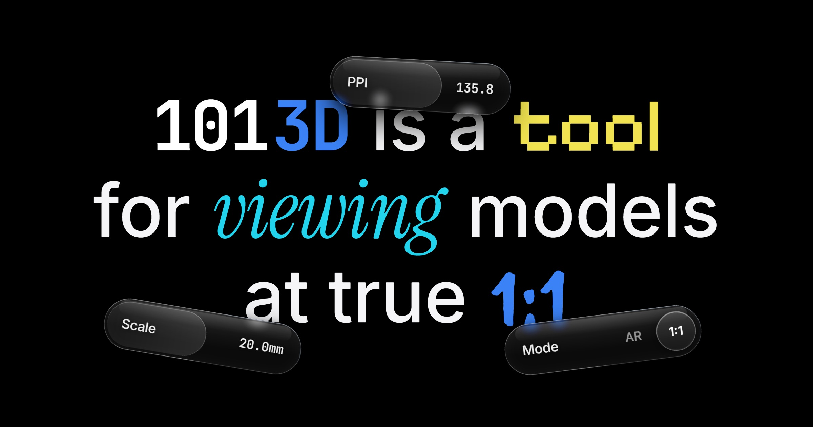

<div align="center">
  <a href="https://1013d.pages.dev/">
    
  </a>
</div>

<br />

<div align="center">

# 1013D

**Inspect 3D models at their true 1:1 physical size directly in your browser.**

[**Launch 1013D**](https://1013d.pages.dev/)

</div>

## What 1013D Solves

CAD software can tell you a part is 80 mm wide, and standard viewers let you orbit the mesh, yet neither shows how big 80 mm actually feels in hand before printing. 1013D calibrates an orthographic Three.js camera to your screen's physical pixel density so parts render at true millimeter scale on your monitor or tablet, or inside your room via mobile AR.

## Features

* **True 1:1 Physical Scale**: Toggles an orthographic camera locked to your calibrated PPI so you can hold a ruler, caliper, PCB, or hardware directly up to the screen for fit verification.
* **Screen & Card Calibration**: Auto calculate PPI from detected logical resolution and monitor diagonal inches, or scale an interactive gauge against a standard ISO/IEC 7810 ID 1 credit card (85.60 mm x 53.98 mm).
* **STL, OBJ, and 3MF Support**: Load multiple binary or ASCII `.stl`, `.obj`, and `.3mf` files locally, or click **Try Example** to inspect the bundled 20 mm calibration cube.
* **Wireframe Overlay & Transform Tools**: Switch between shaded view and shaded with wireframe overlay, snap camera orientation to `X`, `Y`, or `Z` axes, reposition or rotate models with optional 15 degree snap, and edit live millimeter dimensions.
* **Mobile AR Export**: Converts the scene on demand to GLB and USDZ for iOS AR Quick Look, Android Scene Viewer, and WebXR.
* **Client Side Privacy**: All mesh parsing, scaling, and AR exporting run locally in your browser without uploading files to any server.

## Quick Calibration Example

1. Open [1013D](https://1013d.pages.dev/) and load an `.stl`, `.obj`, or `.3mf` file.
2. Open the **Calibration** tab to enter your monitor diagonal size or complete credit card calibration.
3. Click **`1:1`** on the bottom toolbar to lock physical scale (`20 mm` renders as `20 mm` on the calibrated screen).

## Local Development

Requirements: Node.js 18+ and npm.

```bash
git clone https://github.com/dexterchock/1013d.git
cd 1013d
npm install
npm run dev
```

Useful scripts:

```bash
npm run typecheck
npm run build
npm run preview
```

## Tech Stack

* TypeScript, React, Vite, Tailwind CSS, Zustand
* Three.js, React Three Fiber, Drei, `@google/model-viewer`

## Agentic Discovery

Machine readable discovery metadata for LLM crawlers and browser agents is published at `/llms.txt`, `/.well-known/ard.json`, and `/.well-known/agent-skill.md`.

## Author

**[Dexter Chock](https://github.com/dexterchock)**

<div align="center">
  <sub>© 2026 1013D</sub>
</div>
