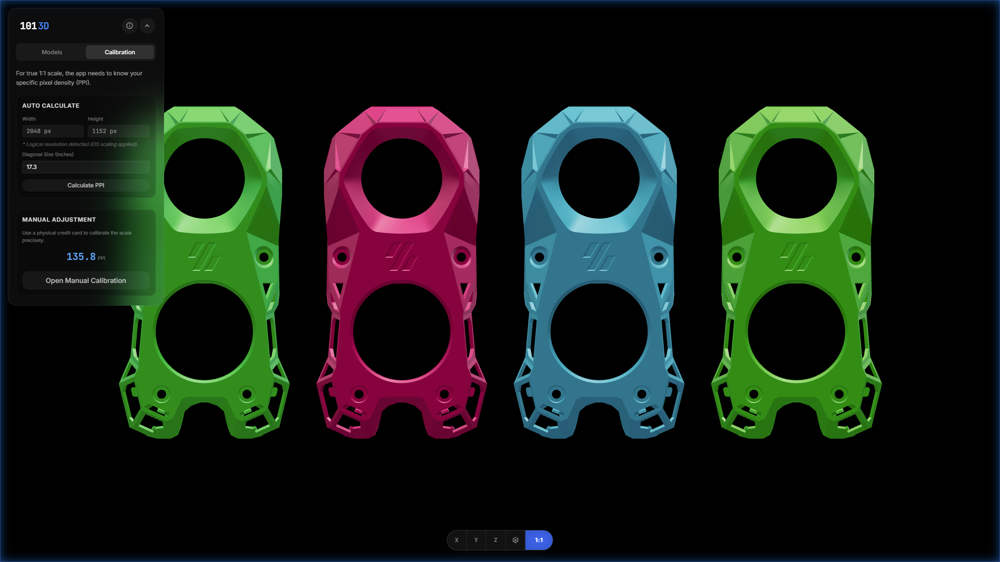

<div align="center">
  
</div>

<br />

<div align="center">

# 1013D

**Inspect 3D models at their true 1:1 physical size directly in your browser.**

</div>

## Overview

CAD tells you a part is 80 mm wide, and standard viewers let you orbit a mesh, yet neither shows how big 80 mm actually feels before printing. 1013D calibrates an orthographic Three.js camera to your screen's pixel density so models render at exact millimeter scale on desktop or tablet, or at true scale in your room through mobile AR.

## Features

* **True 1:1 Physical Scale**: Locks an orthographic camera to your calibrated PPI so you can hold a ruler, caliper, PCB, or hardware right up to the display for fit checks.
* **Screen and Card Calibration**: Calculates PPI from logical screen resolution and monitor diagonal inches, or lets you match an interactive gauge against a physical ISO/IEC 7810 ID 1 credit card (`85.60 mm x 53.98 mm`).
* **STL, OBJ, and 3MF Support**: Load multiple binary or ASCII `.stl`, `.obj`, and `.3mf` files locally, or click **Try Example** to inspect the bundled 20 mm calibration cube.
* **Wireframe and Transform Tools**: Switch between shaded view and shaded with wireframe overlay, snap camera views to `X`, `Y`, or `Z` axes, move or rotate models with optional 45 degree snap, and edit live millimeter dimensions.
* **Mobile AR Export**: Exports scenes on demand to GLB and USDZ for iOS AR Quick Look, Android Scene Viewer, and WebXR.
* **Local Browser Processing**: Mesh parsing, scaling, and AR exports run locally in your browser without uploading files to a server.

## Quick Calibration

1. Open the viewer and drop an `.stl`, `.obj`, or `.3mf` file onto the canvas.
2. Open the **Calibration** tab to enter your monitor diagonal size or calibrate with a physical card.
3. Click **`1:1`** on the bottom toolbar to lock physical scale (`20 mm` renders as `20 mm` on the calibrated screen).

## Local Development

Requires Node.js 18+ and npm.

```bash
git clone https://github.com/dexterchock/1013d.git
cd 1013d
npm install
npm run dev
```

Scripts:

```bash
npm run typecheck
npm run build
npm run preview
```

## Tech Stack

* TypeScript, React, Vite, Tailwind CSS, Zustand
* Three.js, React Three Fiber, Drei, `@google/model-viewer`

<div align="center">
  <sub>© 2026 1013D</sub>
</div>
